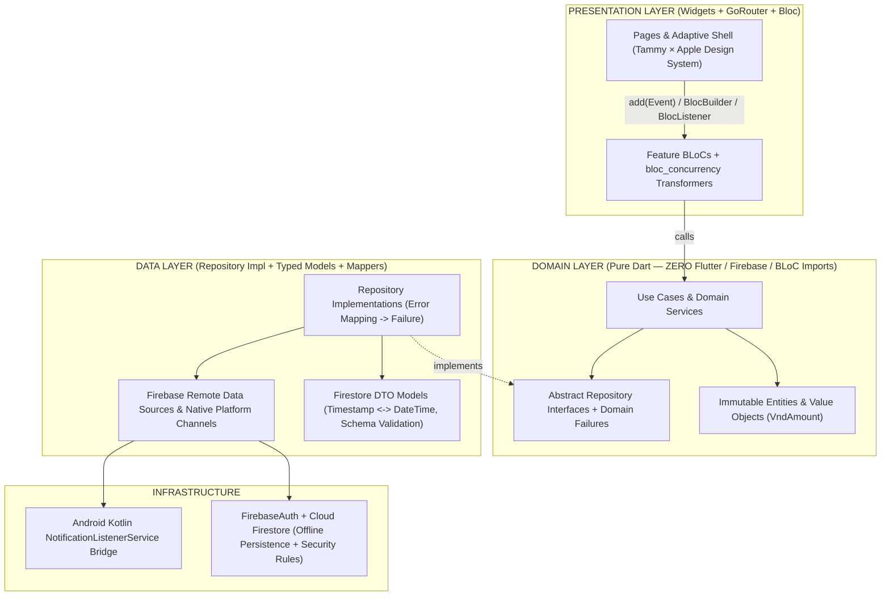

# KIẾN TRÚC KỸ THUẬT FLUTTER CLEAN ARCHITECTURE + BLOC + FIREBASE

> **Dự án:** Life OS — Super App Quản lý Cuộc sống & Gia đình  
> **Chuẩn kiến trúc:** Feature-First Clean Architecture (`PRESENTATION → DOMAIN ← DATA → Firebase`)  
> **Quản lý trạng thái:** **100% BLoC Event → State (`Bloc<Event, State>`) + `bloc_concurrency` — NGHIÊM CẤM `Cubit`**

---

## 1. Sơ đồ Phân tầng & Quy tắc Phụ thuộc (Dependency Rule)

### Các Ràng buộc Bất biến (Kiểm chứng Tự động bằng Unit Test)
1. **Không dùng `Cubit`:** Không một lớp nào trong `lib/` kế thừa `Cubit` hoặc sử dụng `ChangeNotifier`/`Riverpod`/`GetX` cho nghiệp vụ. Ngay cả chuyển đổi giao diện Sáng/Tối (`ThemeBloc`) cũng là `Bloc<ThemeEvent, ThemeState>`.
2. **Tinh khiết Tầng Domain:** Các tệp trong `lib/features/*/domain/**` không được phép `import 'package:flutter/...'`, `import 'package:cloud_firestore/...'`, `import 'package:firebase_auth/...'` hay `import 'package:flutter_bloc/...'`.
3. **Cô lập Tầng Presentation:** Widget và BLoC không bao giờ import `cloud_firestore` hay biết tên collection của Firestore.
4. **Không phụ thuộc chéo giữa các BLoC:** BLoC của feature A không bao giờ nhận hoặc giữ tham chiếu tới BLoC của feature B.

---

## 2. Chiến lược BLoC Event Concurrency (`bloc_concurrency`)

| Chiến lược Transformer | Khi nào sử dụng trong Life OS | Ví dụ Event cụ thể |
| --- | --- | --- |
| `restartable()` | Đăng ký lắng nghe realtime stream từ Firestore (`emit.forEach`), đổi bộ lọc tháng, tìm kiếm từ khóa | `AuthSubscriptionRequested`, `TransactionsSubscriptionRequested`, `TransactionsSearchChanged`, `CalendarWatchStarted`, `DashboardWatchStarted` |
| `sequential()` | Mọi thao tác ghi dữ liệu tài chính, góp/chi quỹ, tạo/sửa nhiệm vụ, cập nhật Odometer/bảo dưỡng, cấp/thu hồi consent cần bảo toàn thứ tự nghiêm ngặt | `TransactionCreateSubmitted`, `TransactionReversalRequested`, `FundContributionAdded`, `TaskResponseSubmitted`, `ConsentToggled` |
| `droppable()` | Chống nhấn đúp nút đăng nhập/đăng ký, tạo mã mời hoặc xuất tệp dữ liệu khi thao tác trước chưa xong | `AuthSignInSubmitted`, `AuthSignUpSubmitted`, `FamilyInviteGenerated`, `PersonalDataExported` |
| `concurrent()` | Các tác vụ đọc phụ trợ hoàn toàn độc lập | Tải kiểm tra độc lập không ảnh hưởng trạng thái ghi |

> **Bảo vệ kép cho giao dịch tài chính:** Bên cạnh `sequential()` ở tầng BLoC, mọi lệnh tạo giao dịch đều mang `operationId` (khóa lũy đẳng làm Document ID `users/{uid}/transactions/{operationId}`) kết hợp `FirebaseFirestore.runTransaction` để đảm bảo không bao giờ ghi đúp số tiền ngay cả khi mạng chập chờn hoặc retry.

---

## 3. Dependency Injection (`get_it`) & App Routing (`go_router`)

- **Composition Root (`lib/core/di/dependency_injection.dart`):**
  - `registerSingleton`: `FirebaseAuth`, `FirebaseFirestore`, `AndroidNotificationBridge`.
  - `registerLazySingleton`: Toàn bộ `RemoteDataSource`, `RepositoryImpl`, và `UseCase`.
  - `registerFactory`: Toàn bộ `Bloc` theo vòng đời của màn hình/feature (trừ `AuthBloc` và `ThemeBloc` được cấp ở gốc `LifeOsApp` và giải phóng đúng chuẩn khi đóng ứng dụng).
- **Routing (`lib/app/app_router.dart`):**
  - Sử dụng `GoRouter` lắng nghe stream trạng thái của `AuthBloc`:
    - Chưa xác thực → chuyển hướng an toàn về `/login` (hoặc `/register`).
    - Đã xác thực nhưng `onboardingCompleted == false` → chuyển tới `/onboarding`.
    - Đã hoàn tất → vào `StatefulShellRoute.indexedStack` với 5 nhánh chính: `/today`, `/finance`, `/planning`, `/family`, `/assets` và màn hình chuyên sâu `/notifications-privacy`.

---

## 4. Hệ thống Giao diện “Tammy × Apple” (`lib/app/theme/`)

Hiện thực hóa đầy đủ đặc tả trong `a.docx`:
- **Semantic Color Tokens (`AppColors` & `TammyThemeExtension`):**
  - Light: `primary #0B7A2A`, `onPrimary #FFFFFF`, `primarySubtle #E7F7EB`, `secondary #0057B8`, `background #F2F2F7`, `surface #FFFFFF`, `surfaceRaised #F7F7FA`, `textPrimary #1D1D1F`, `textSecondary #54545A`, `success #006D5B`, `warning #8A4B00`, `error #B42318`.
  - Dark: `primary #19C23E`, `onPrimary #000000`, `primarySubtle #123C1F`, `secondary #64D2FF`, `background #000000`, `surface #1C1C1E`, `surfaceRaised #2C2C2E`, `textPrimary #F5F5F7`, `textSecondary #B8B8BE`, `success #63E6BE`, `warning #FFD60A`, `error #FF453A`.
- **Liquid Glass Tiết chế:** Thanh điều hướng trên và thanh Tab Bar dưới sử dụng `ClipRect` + `BackdropFilter(ImageFilter.blur)` bán trong suốt; toàn bộ thẻ nội dung (`Card`) dùng bề mặt đặc (`surface`), bo góc `16pt`, viền mảnh tinh tế.
- **Accessibility & Adaptive Layout:** Vùng tương tác tối thiểu `44 × 44 pt`, hỗ trợ `TextScaler`, luôn hiển thị kèm Icon + Nhãn chữ cho mọi trạng thái, tự động chuyển từ `NavigationBar` (màn hình `< 840dp`) sang `NavigationRail` chuẩn Apple Split View (màn hình `>= 840dp`).
