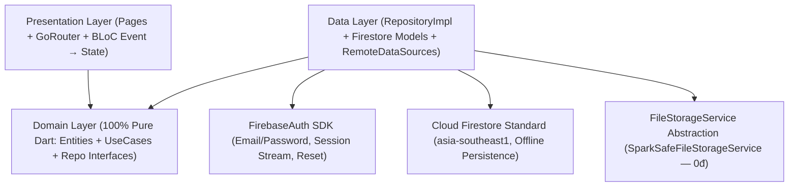

# KIẾN TRÚC TÍCH HỢP FIREBASE & TỐI ƯU HẠN MỨC SPARK (FIREBASE ARCHITECTURE)

**Phiên bản:** 1.0 | **Cập nhật:** 22/11/2026 | **Chuẩn kiến trúc:** Feature-First Clean Architecture + BLoC Event-Driven (`0% Cubit`)

---

## 1. Sơ đồ Tích hợp Tầng Hạ tầng Firebase

### Nguyên tắc Ranh giới Nghiêm ngặt (Kiểm chứng tự động bởi `architecture_guard_test.dart`)
1. **Không gọi Firebase từ UI hoặc BLoC:** Toàn bộ `Presentation` có `0` dòng import `cloud_firestore` hay `firebase_auth`.
2. **Domain độc lập 100%:** `Domain` chỉ chứa thực thể thuần Dart, tiền tệ nguyên đồng `VND` (`int`) và interface repository.
3. **Khởi tạo duy nhất không trùng lặp (`FirebaseConfig.initialize()`):** Kiểm tra `if (Firebase.apps.isEmpty)` trước khi gọi `Firebase.initializeApp(options: DefaultFirebaseOptions.currentPlatform)`, bật `Settings(persistenceEnabled: true)` để hỗ trợ lưu tạm ngoại tuyến và tự đồng bộ khi có mạng.
4. **Chuyển mạch Emulator ↔ Cloud tự động:**
   - Khi `projectId` bắt đầu bằng `'demo-'` hoặc truyền `--dart-define=USE_FIREBASE_EMULATOR=true`: kết nối tới `127.0.0.1:9199` (Auth) và `127.0.0.1:8188` (Firestore) — hoặc `10.0.2.2` trên máy ảo Android.
   - Ngay khi `flutterfire configure` ghi `projectId` thật vào `lib/firebase_options.dart`: ứng dụng tự động kết nối trực tiếp tới **Firebase Cloud** mà không cần sửa bất kỳ dòng mã nguồn nào.

---

## 2. Chiến lược Lưu trữ File & Ảnh (`PHẦN 11` — Giữ Nguyên Gói Spark 0 ₫)

- **Dữ liệu có cấu trúc (Hồ sơ, Ví, Giao dịch, Tách khoản, Ngân sách, Quỹ, Chia tiền nhóm/gia đình, Lịch, Giao việc, Xe, Hóa đơn):** Lưu trên **Cloud Firestore Standard**.
- **Ảnh hóa đơn / tệp đính kèm nhị phân:** Do **Cloud Storage for Firebase** hiện yêu cầu nâng cấp lên gói **Blaze** (liên kết thẻ thanh toán), dự án tuân thủ nghiêm ngặt quy tắc **không tự nâng cấp Blaze** và **không nhét dữ liệu nhị phân lớn vào Firestore**.
- Đã triển khai interface [`FileStorageService`](file:///g:/superapp/lib/core/services/file_storage_service.dart) kèm `SparkSafeFileStorageService` đăng ký trong `get_it` (`dependency_injection.dart`), sẵn sàng cắm adapter Cloudflare R2 / S3 / Firebase Storage về sau mà không ảnh hưởng tới Domain hay BLoC.

---

## 3. Chiến lược Kiểm soát Chi phí 0 Đồng trên Gói Spark (`PHẦN 14`)

Gói Firebase Spark miễn phí cung cấp **50.000 lượt đọc / ngày**, **20.000 lượt ghi / ngày**, **20.000 lượt xóa / ngày** và **1 GiB lưu trữ**. Life OS kiểm soát chặt chẽ hạn mức qua 6 cơ chế kỹ thuật:

1. **Phân vùng Truy vấn theo Kỳ (`monthKey = 'YYYY-MM'`) + `limit(100)`:** `TransactionRemoteDataSource.watchTransactions` chỉ lắng nghe đúng tháng đang xem với giới hạn tối đa `100` bản ghi thay vì tải toàn bộ lịch sử nhiều năm.
2. **Hủy Listener Tự động (`restartable()` + Scoped `BlocProvider`):** Khi người dùng đổi tháng tìm kiếm hoặc chuyển hộ gia đình hoặc đăng xuất, `bloc_concurrency` `restartable()` và `ValueKey('shell_${user.id}_...')` hủy ngay lập tức toàn bộ stream cũ, không bao giờ rò rỉ realtime listener.
3. **Phi chuẩn hóa Có kiểm soát (`memberIds`, `memberRoles`, `memberNames` ngay trên `families/{familyId}`):** Giúp giao diện hiển thị tên/vai trò thành viên và giúp `firestore.rules` kiểm tra quyền bằng đúng `1` lệnh `get()`, tránh $N$ lượt đọc nối bảng như SQL.
4. **Gộp Ghi Nguyên tử (`WriteBatch` & `runTransaction`):** Khởi tạo không gian người dùng mới gom toàn bộ `user` + `wallet_cash_default` + `15 categories` + `consent` vào một `WriteBatch` duy nhất; tạo giao dịch + cập nhật số dư ví gom vào một `runTransaction` duy nhất.
5. **Khử Trùng lặp tại Biên (`operationId` & `source_events/{eventKey}`):** Ngăn chặn hoàn toàn vòng lặp ghi lặp khi mạng chập chờn hoặc thông báo ngân hàng gửi lại nhiều lần.
6. **Không bật dịch vụ phát sinh phí:** Không cấu hình Cloud Functions, Cloud Storage, Cloud Run hay Firestore Enterprise.
