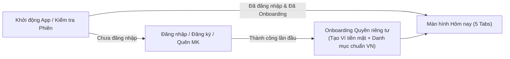
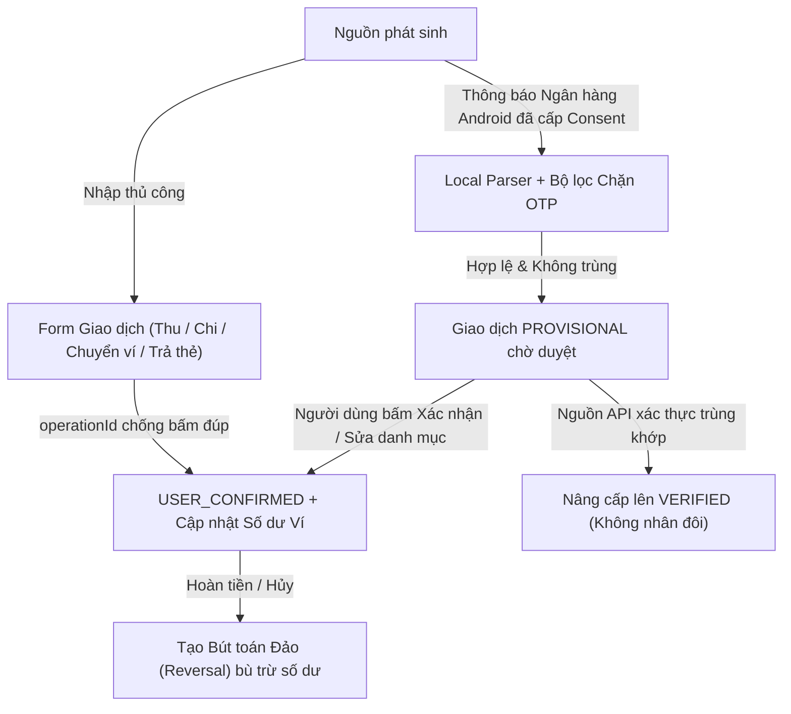
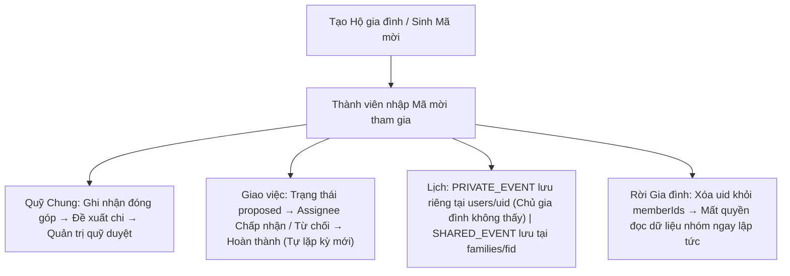
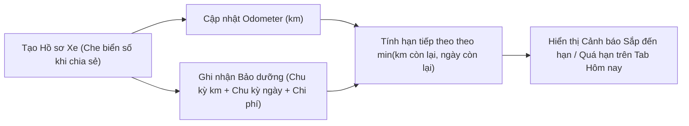

# LUỒNG NGƯỜI DÙNG CHI TIẾT (USER FLOWS)

## 1. Luồng Xác thực & Khởi tạo Không gian Riêng tư

## 2. Luồng Ghi nhận Tài chính, Chuyển ví & Duyệt Giao dịch Thông báo

## 3. Luồng Phối hợp Gia đình, Quỹ Chung & Giao việc Bảo toàn Đời tư

## 4. Luồng Phương tiện, Bảo dưỡng & Hóa đơn Định kỳ

