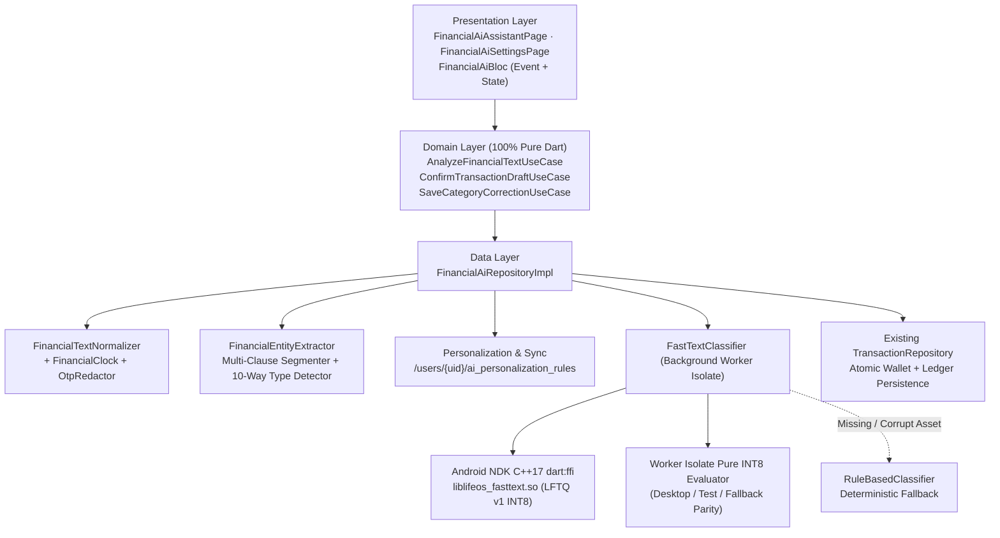

# Hướng dẫn Tích hợp Kiến trúc — Offline Financial AI (`integration_guide.md`)

## 1. Sơ đồ Kiến trúc Clean Architecture & Luồng Dữ liệu

Tính năng được triển khai hoàn toàn độc lập tại [`lib/features/financial_ai/`](file:///g:/superapp/lib/features/financial_ai/), tuân thủ nghiêm ngặt quy tắc **Clean Architecture + BLoC (`Event` / `State`, 0% `Cubit`)**:

---

## 2. Danh mục Tệp Nguồn Chính

### 2.1. Native C++17 & Android NDK (`dart:ffi`)
- [`android/app/src/main/cpp/CMakeLists.txt`](file:///g:/superapp/android/app/src/main/cpp/CMakeLists.txt): Cấu hình biên dịch thư viện chia sẻ `liblifeos_fasttext.so` với cờ căn chỉnh trang bộ nhớ 16KB chuẩn Android 15+ (`-Wl,-z,max-page-size=16384`) và tối ưu `-O3`.
- [`android/app/src/main/cpp/lifeos_fasttext_ffi.cpp`](file:///g:/superapp/android/app/src/main/cpp/lifeos_fasttext_ffi.cpp): Bộ giải mã định dạng nhị phân `LFTQ` v1 và nhân ma trận lượng tử hóa `INT8` tốc độ cao kèm kiểm tra tràn bộ nhớ nghiêm ngặt.
- [`lib/features/financial_ai/data/inference/fasttext_ffi_io.dart`](file:///g:/superapp/lib/features/financial_ai/data/inference/fasttext_ffi_io.dart) & [`fasttext_ffi_stub.dart`](file:///g:/superapp/lib/features/financial_ai/data/inference/fasttext_ffi_stub.dart): Cầu nối `dart:ffi` an toàn đa nền tảng.

### 2.2. Domain Layer (`0%` phụ thuộc Flutter / Firebase / BLoC)
- [`lib/features/financial_ai/domain/entities/financial_ai_entities.dart`](file:///g:/superapp/lib/features/financial_ai/domain/entities/financial_ai_entities.dart): Toàn bộ thực thể bất biến (`FinancialAnalysisRequest`, `ExtractedFinancialEntity`, `TransactionCandidate`, `ConfidenceBreakdown`, `PersonalizationRule`, `FinancialClock`, `AmbiguityFlag`).
- [`lib/features/financial_ai/domain/services/financial_classifier.dart`](file:///g:/superapp/lib/features/financial_ai/domain/services/financial_classifier.dart): Giao diện trừu tượng `FinancialClassifier`.
- [`lib/features/financial_ai/domain/repositories/financial_ai_repository.dart`](file:///g:/superapp/lib/features/financial_ai/domain/repositories/financial_ai_repository.dart): Hợp đồng `FinancialAiRepository`.
- [`lib/features/financial_ai/domain/usecases/financial_ai_usecases.dart`](file:///g:/superapp/lib/features/financial_ai/domain/usecases/financial_ai_usecases.dart): 8 UseCase nghiệp vụ kèm chốt chặn an toàn kế toán Phase 17.

### 2.3. Data Layer
- [`lib/features/financial_ai/data/normalization/financial_text_normalizer.dart`](file:///g:/superapp/lib/features/financial_ai/data/normalization/financial_text_normalizer.dart): Chuẩn hóa tiếng Việt có dấu/không dấu, viết tắt, số tiền nguyên `int` minor units, ngày tương đối.
- [`lib/features/financial_ai/data/extraction/financial_entity_extractor.dart`](file:///g:/superapp/lib/features/financial_ai/data/extraction/financial_entity_extractor.dart): Lọc câu phi giao dịch / OTP / phủ định / hủy lệnh, tách câu đa khoản thu chi, nhận diện 10 loại nghiệp vụ tài chính.
- [`lib/features/financial_ai/data/inference/fasttext_classifier.dart`](file:///g:/superapp/lib/features/financial_ai/data/inference/fasttext_classifier.dart): Quản lý vòng đời **Worker `Isolate` chạy nền duy nhất** (lazy-load 1 lần, kiểm tra SHA-256, tự động chuyển sang `RuleBasedClassifier` khi model lỗi/thiếu).
- [`lib/features/financial_ai/data/personalization/confidence_policy_engine.dart`](file:///g:/superapp/lib/features/financial_ai/data/personalization/confidence_policy_engine.dart): Tính điểm tự tin đa chiều và quyết định chính sách xác nhận.

### 2.4. Presentation Layer & Điểm Kết nối Giao diện
- [`lib/features/financial_ai/presentation/bloc/financial_ai_bloc.dart`](file:///g:/superapp/lib/features/financial_ai/presentation/bloc/financial_ai_bloc.dart): `FinancialAiBloc` sử dụng `restartable()` cho phân tích văn bản và `droppable()` chống bấm đúp khi ghi sổ.
- [`lib/features/financial_ai/presentation/pages/financial_ai_assistant_page.dart`](file:///g:/superapp/lib/features/financial_ai/presentation/pages/financial_ai_assistant_page.dart): Màn hình nhập câu đa khoản, nghe giọng nói tiếng Việt và thẻ duyệt nháp chi tiết (`/financial-ai`).
- [`lib/features/financial_ai/presentation/pages/financial_ai_settings_page.dart`](file:///g:/superapp/lib/features/financial_ai/presentation/pages/financial_ai_settings_page.dart): Màn hình quản lý quy tắc cá nhân hóa, bật/tắt AI & xóa dữ liệu học trên máy (`/financial-ai-settings`).

---

## 3. Tích hợp với Thông báo Ngân hàng, Giọng nói & Quyền Riêng tư

1. **Thông báo Ngân hàng Android ([`notifications_repository_impl.dart`](file:///g:/superapp/lib/features/notifications/data/repositories/notifications_repository_impl.dart)):**
   - Ngay sau khi `BankNotificationParser` bóc tách số tiền, chiều thu/chi và nội dung chuyển khoản, `NotificationsRemoteDataSource` gọi `FinancialAiRepository` để tra cứu quy tắc cá nhân hóa của riêng người dùng và phân loại bằng model FastText offline trước khi lưu giao dịch.
2. **Nhập Giọng nói ([`voice_smart_capture_sheet.dart`](file:///g:/superapp/lib/core/widgets/voice_smart_capture_sheet.dart)):**
   - Cho phép chuyển trực tiếp bản ghi âm tiếng Việt sang `/financial-ai` với nguồn `FinancialInputSource.voiceTranscript` để xem trước, chỉnh sửa từng khoản tách rời trước khi xác nhận.
3. **Cô lập Dữ liệu Cá nhân & Xóa Tài khoản ([`firestore.rules`](file:///g:/superapp/firestore.rules)):**
   - Các bộ sưu tập `ai_personalization_rules`, `ai_category_corrections`, `ai_pending_drafts`, `ai_preferences` chỉ cho phép `isOwner(userId)` đọc/ghi (thành viên khác trong Gia đình không thể đọc).
   - Khi người dùng xóa tài khoản (`deleteAccountAndPersonalData`), cả 4 bộ sưu tập AI được xóa sạch cùng toàn bộ dữ liệu cá nhân.
