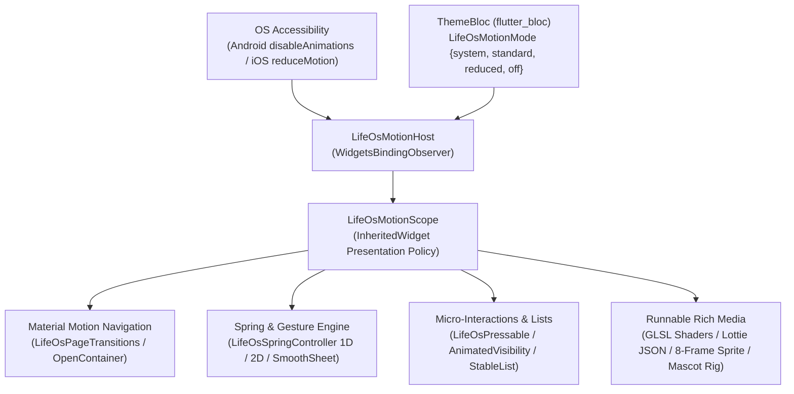

# Tài Liệu Đặc Tả API, Duration, Curve & Spring Physics — LifeOS Motion Design System v2.0

**Phiên bản:** `2.0` (`v3.21.0+37`) · **Vị trí mã nguồn trung tâm:** `lib/core/motion/` · **Màn hình trải nghiệm trực quan (66 mẫu):** `/motion-gallery` (`lib/features/motion_gallery/`)

---

## 1. Kiến Trúc Tổng Thể & Ranh Giới Clean Architecture

### Nguyên tắc bất biến:
1. **0% rò rỉ vào Domain / Data:** Không có bất kỳ `AnimationController`, `Ticker`, `Curve`, `SpringDescription` hay `Widget` nào trong `domain/` hoặc `data/`.
2. **0% cập nhật BLoC theo từng khung hình (60/120 Hz):** Mọi chuyển động kéo tay, sóng âm thanh RMS (`ValueNotifier<double>`), thời gian shader (`uTime`), `scrollRatio` carousel chạy hoàn toàn trong `State` cục bộ + `RepaintBoundary`. Chỉ gửi `Event` vào `BLoC` tại thời điểm người dùng chốt hành động.
3. **Không phát lại hiệu ứng vô lý khi Widget rebuild:** Sử dụng `LifeOsOneShotEffectTracker` (khóa `operationId`/`effectKey`) và `LifeOsStableListRegistry` (khóa `id` nghiệp vụ, trần tối đa `5` phần tử stagger, tự bỏ qua khi đồng bộ hàng loạt).
4. **Phân biệt minh bạch Ảnh Tĩnh AI và Hoạt Ảnh Chạy Thật:**
   - **Ảnh 3D tĩnh (`Nano Banana`):** `mascot_leafy_guardian.jpg`, `banner_motion_studio_3d.jpg`, `ic_motion_physics_3d.jpg` — dùng làm chân dung concept, banner studio và icon 3D.
   - **Hoạt ảnh chạy thật 100%:** Vector timeline **Lottie** (`assets/lottie/*.json`), **GLSL Fragment Shaders** (`shaders/*.frag`), **Sprite Sheet 8 khung hình RGBA** (`coin_spin_spritesheet.png` + `LifeOsSpriteSheetPlayer`), **Hệ hạt vật lý** (`LifeOsParticleBurst`) và **Linh vật State-Machine 5 trạng thái** (`LifeOsInteractiveMascotRig`).

---

## 2. Bảng Duration Tokens (`LifeOsMotionTokens`)

| Token | Thời lượng | Mục đích UX chuẩn | Khi bật `Reduce Motion` | Khi `Motion Off` |
|---|---:|---|---:|---:|
| `instant` | `0 ms` | Thay thế tức thì không chuyển cảnh | `0 ms` | `0 ms` |
| `feedbackFast` | `100 ms` | Phản hồi chạm xuống, đổi độ mờ khi giảm chuyển động | `100 ms` | `0 ms` |
| `micro` | `160 ms` | Đổi trạng thái icon, dấu kiểm, badge, `LifeOsTruthfulNumericText` | `100 ms` | `0 ms` |
| `standard` | `220 ms` | Chuyển nhánh tab chính, mở/đóng `"Chi tiết"`, hiện `LifeOsTopToast` | `100 ms` | `0 ms` |
| `medium` | `300 ms` | Điều hướng `SharedAxisTransition`, đổi kỳ lịch, thanh tiến độ | `100 ms` | `0 ms` |
| `panel` | `340 ms` | Mở bảng chọn đáy (`ModalBottomSheet`), trượt thanh dock | `100 ms` | `0 ms` |
| `expressive` | `420 ms` | Dấu xác nhận hoàn tất cột mốc quan trọng | `100 ms` | `0 ms` |
| `longEmphasis` | `520 ms` | Trần thời lượng tối đa cho hiệu ứng nhấn mạnh không chặn thao tác | `100 ms` | `0 ms` |
| `exitFast` | `140 ms` | Đóng nhanh popup/toast để không cản cú chạm tiếp theo | `100 ms` | `0 ms` |
| `exitStandard` | `180 ms` | Pop màn hình con về màn hình cha | `100 ms` | `0 ms` |

---

## 3. Bảng Easing Curves & 6 Lò Xo Vật Lý (`SpringDescription`)

### 3.1. Đường cong Easing
- `standardCurve` (`Curves.easeOutCubic`): Vào nhanh, giảm tốc mượt, `0%` vọt lố.
- `exitCurve` (`Curves.easeInCubic`): Thoát gọn không giữ màn hình.
- `emphasizedCurve` (`Cubic(0.2, 0.0, 0.0, 1.0)`): Chuẩn Material 3 Emphasized cho chuyển cảnh & biểu đồ.
- `emphasizedDecelerate` (`Cubic(0.05, 0.7, 0.1, 1.0)`): Đón phần tử đi vào khung nhìn.
- `emphasizedAccelerate` (`Cubic(0.3, 0.0, 0.8, 0.15)`): Đưa phần tử rời khung nhìn.

### 3.2. Hệ 6 Lò Xo Vật Lý Chuẩn Hóa ($\zeta = \frac{c}{2\sqrt{mk}}$)

| Spring Token | `mass` | `stiffness` ($k$) | `damping` ($c$) | Tỷ số tắt dần $\zeta$ | Vọt lố (Overshoot) | Ngữ cảnh sử dụng & Ràng buộc an toàn |
|---|---:|---:|---:|---:|---:|---|
| `pressSpring` | `1.0` | `600.0` | `43.0` | `0.878` | `< 0.3%` | `LifeOsPressable` phản hồi nhấn/nhả xúc giác tức thì, giữ nguyên 100% vùng chạm ngoài. |
| `snappySpring` | `1.0` | `500.0` | `42.5` | `0.950` | `~0%` | Thanh chọn phân đoạn, viên nang `LiquidGlassSlidingDock`, công tắc gạt nhanh. |
| `bouncySpring` | `1.0` | `380.0` | `24.0` | `0.616` | `~8.5%` | Nhịp nảy linh vật `"Mầm Ngọc"`, huy hiệu hoàn thành mục tiêu. **Cấm dùng cho số tiền & biểu đồ.** |
| `sheetSnapSpring` | `1.0` | `340.0` | `37.0` | `1.003` | **`0%`** | Bắt nấc `LifeOsSpringBottomSheet` & ngăn kéo cạnh trái, không bao giờ nảy hở đáy màn hình. |
| `gestureThrowSpring` | `1.0` | `260.0` | `26.0` | `0.806` | `~1.4%` | Kéo thả thẻ 2D (`LifeOsSpring2DController`), vuốt duyệt thẻ và trả về tâm từ tính. |
| `chartMorphSpring` | `1.0` | `240.0` | `31.0` | `1.001` | **`0%`** | Biến thiên lát biểu đồ tròn, chiều cao cột dòng tiền, vòng tiến độ (tắt dần tới hạn tuyệt đối). |

- **Sai số dừng theo hệ quy chiếu:**
  - Không gian chuẩn hóa `[0..1]`: `springTolerance = Tolerance(distance: 0.001, velocity: 0.01)`.
  - Không gian điểm ảnh (`px`): `pixelSpringTolerance = Tolerance(distance: 0.5, velocity: 5.0)`.
- **Bảo toàn vận tốc & Đổi đích giữa chừng (Mid-Flight Retargeting):**
  - `LifeOsSpringController.animateTo(target, velocity: v)` lấy trực tiếp `[value, velocity]` tức thời làm điều kiện đầu cho `SpringSimulation`, đảm bảo liên tục vị trí $C^0$ và vận tốc $C^1$ ngay cả khi người dùng đổi ý bấm liên tiếp `Tab 0 -> 3 -> 1`.
  - Hỗ trợ co giãn tốc độ thử nghiệm (`timeDilationFactor`: `k' = k * s^2`, `c' = c * s`) giữ nguyên chính xác hệ số tắt dần $\zeta$ ở chế độ quay chậm `0.25x` và `0.5x` trong Motion Studio!

---

## 4. Danh Mục API Tái Sử Dụng (`package:life_os/core/motion/lifeos_motion.dart`)

| API / Widget | File định nghĩa | Công dụng chính |
|---|---|---|
| `LifeOsMotionScope` / `LifeOsMotionHost` | `lifeos_motion_scope.dart` | Cung cấp `LifeOsMotionPreferences` xuống cây widget, tự lắng nghe thay đổi trợ năng hệ điều hành thời gian thực. |
| `LifeOsPageTransitions` | `navigation/lifeos_page_transitions.dart` | Tạo trang `GoRouter` chuẩn Material Motion (`sharedAxis`, `fadeThrough`, `fadeScale`). |
| `LifeOsOpenContainer<T>` | `navigation/lifeos_page_transitions.dart` | Container Transform mở mượt từ thẻ/FAB sang màn chi tiết, tự chuyển về fade ngắn khi bật Reduce Motion. |
| `LifeOsMaterialContentSwitcher` | `navigation/lifeos_page_transitions.dart` | Chuyển đổi nội dung cục bộ bằng `PageTransitionSwitcher` (`SharedAxis` / `FadeThrough`). |
| `LifeOsSpringController` / `LifeOsSpring2DController` | `physics/lifeos_spring_controllers.dart` | Bộ điều khiển lò xo 1 chiều & 2 chiều bảo toàn vận tốc cử chỉ, hỗ trợ bắt dính giữa chừng (`jumpTo`). |
| `LifeOsPhysicsAnimatedBox` | `physics/lifeos_spring_controllers.dart` | Khung thay đổi kích thước & bo góc bằng vật lý lò xo không đứt quãng vận tốc. |
| `LifeOsPerspectiveCarousel` | `physics/lifeos_spring_controllers.dart` | Băng chuyền phối cảnh 3D cung cấp tỷ lệ cuộn liên tục `scrollRatio` $\in [-1.5, +1.5]$. |
| `LifeOsSpringBottomSheet` / `showLifeOsSpringSheet` | `widgets/lifeos_smooth_sheet.dart` | Bottom sheet đa nấc (`detents`) tích hợp kháng lực cao su (`rubberBandClamp`) và dự báo nấc dừng theo vận tốc vẩy tay (`projectNearestDetent`). |
| `LifeOsPressable` | `widgets/lifeos_pressable.dart` | Vỏ phản hồi nhấn lò xo `pressSpring`, hỗ trợ `passthroughPointerOnly: true` không tranh chấp `InkWell`. |
| `LifeOsAnimatedVisibility` | `widgets/lifeos_animated_visibility.dart` | Đóng/mở chiều cao + độ mờ mượt mà, tự khóa `IgnorePointer` và `ExcludeSemantics` khi ẩn. |
| `LifeOsStableListRegistry` / `LifeOsAnimatedItemEntrance` | `widgets/lifeos_animated_list.dart` | Quản lý stagger danh sách tối đa 5 dòng mới, chặn phát lại khi stream/BLoC rebuild. |
| `LifeOsTruthfulNumericText` / `LifeOsOneShotEffectTracker` | `lifeos_motion_feedback.dart` | Hiển thị số tiền `tabularFigures()` trung thực (không đếm giả từ 0) & khóa hiệu ứng xác nhận 1 lần. |
| `LifeOsLottieAnimation` | `widgets/lifeos_creative_motion_primitives.dart` | Phát hoạt ảnh vector Lottie (`assets/lottie/*.json`) có đổi màu theo Light/Dark và giới hạn chu kỳ an toàn kiểm thử. |
| `LifeOsSpriteSheetPlayer` | `widgets/lifeos_creative_motion_primitives.dart` | Phát hoạt ảnh cắt khung hình RGBA thực tế (`coin_spin_spritesheet.png`). |
| `LifeOsShaderSurface` | `widgets/lifeos_creative_motion_primitives.dart` | Thực thi GLSL Fragment Shader (`liquid_caustics.frag`, `holographic_foil.frag`) phản hồi chạm/kéo. |
| `LifeOsParticleBurst` | `widgets/lifeos_creative_motion_primitives.dart` | Hệ hạt pháo hoa ăn mừng không cấp phát bộ nhớ trên từng khung hình. |
| `LifeOsInteractiveMascotRig` | `widgets/lifeos_creative_motion_primitives.dart` | Linh vật tương tác `"Mầm Ngọc"` 5 trạng thái với mắt dõi theo ngón tay và lá mầm lò xo. |
