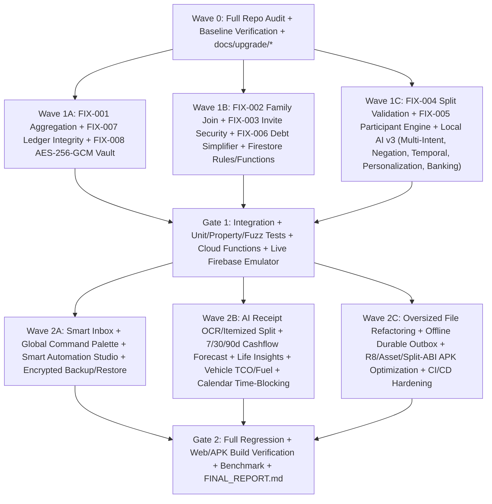

# MASTER PLAN — LIFE OS SUPER APP AUTONOMOUS UPGRADE (FROM v3.26.0+44)

- **Baseline Commit:** `4bc371ef1c3f0b0029f28a6d44228f32f6b6aabd` (`tag: v3.26.0`)
- **Toolchain Verified:** Flutter `3.47.0` (stable), Dart `3.13.0`, Node `v24.11.1`, npm `11.6.2`, OpenJDK `21.0.10 LTS`, Firebase CLI `15.27.0`
- **Architecture Mandates:** Feature-First Clean Architecture + 100% Event-Driven `flutter_bloc` (`0% Cubit`), `LifeOsTopToast` (`0% .showSnackBar(`), strictly zero `TextOverflow` usage in `lib/`, integer VND accounting, strict personal/family RBAC isolation.

## Execution Waves & Dependency Graph (DAG)

## Non-Negotiable Release & Safety Boundaries
1. **No unauthorized push/tag/release:** All commits/changes stay local unless explicitly authorized by the user.
2. **No destructive migrations:** Existing user wallets, transactions, family groups, and documents remain 100% readable and backward-compatible.
3. **Real emulator verification:** `firestore.rules` and `functions/` are verified against Google's live Cloud Firestore Emulator (`127.0.0.1:8188`).
