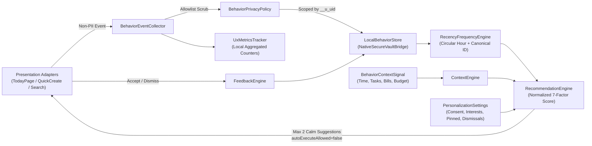

# LifeOS Super App — Đặc Tả Kỹ Thuật User Behavior Engine 2.0

**Kiến trúc:** Tách biệt hoàn toàn khỏi tầng UI (`lib/core/behavior/` pure Dart domain + engine; `lib/core/behavior/local_behavior_store.dart` lưu trữ cục bộ phân vùng theo tài khoản; `lib/core/utils/user_behavior_prefs.dart` façade tương thích ngược).
**Nguyên tắc tuyệt đối:** Offline-first, 100% xử lý trên thiết bị, phân vùng chặt theo `(userId, device, consent)`, không thu thập nội dung nhạy cảm thô, không tự ý thực thi thao tác tài chính.

---

## 1. Kiến Trúc Mô-Đun

---

## 2. Danh Sách 12 Sự Kiện Hành Vi Được Phép (`BehaviorEventType`)

Chỉ các tín hiệu tương tác cấu trúc sau mới được phép thu thập khi người dùng bật cá nhân hóa (`enabled && consentGranted`):

1. `featureOpened` — mở màn hình/phân hệ (`featureKey`)
2. `quickActionUsed` — sử dụng thao tác nhanh (`targetId`)
3. `taskCompleted` — hoàn thành công việc (`featureKey: 'tasks'`)
4. `searchPerformed` — thực hiện tìm kiếm (chỉ lưu độ dài/kết quả, không lưu truy vấn PII vào telemetry)
5. `searchResultSelected` — chọn kết quả tìm kiếm (`featureKey`)
6. `recommendationAccepted` — chấp nhận gợi ý (`targetId`)
7. `recommendationDismissed` — ẩn/từ chối gợi ý (`targetId`)
8. `shortcutPinned` — ghim tiện ích (`targetId`)
9. `shortcutUnpinned` — bỏ ghim tiện ích (`targetId`)
10. `formAbandoned` — rời form chưa lưu (`screenKey`)
11. `validationFailed` — lỗi kiểm tra đầu vào (`screenKey`)
12. `undoRequested` — yêu cầu hoàn tác (`featureKey`)

### Danh sách trường metadata được phép (`BehaviorPrivacyPolicy`)
Chỉ cho phép khóa thuộc allowlist: `targetId`, `featureKey`, `hourOfDay`, `weekday`, `screenKey`, `durationMs`, `stepCount`.
Mọi trường khác (số tiền chi tiết, ghi chú, nội dung tài liệu, transcript giọng nói, thông tin sức khỏe, SĐT, email, số tài khoản) bị **loại bỏ tự động** trước khi ghi xuống `LocalBehaviorStore`.

---

## 3. Công Thức Xếp Hạng Chuẩn Hóa (`RecommendationEngine`)

Tất cả các biến được **chuẩn hóa về miền `[0.0, 1.0]`** trước khi nhân trọng số baseline thử nghiệm:

$$\text{Score} = 0.25 \cdot F_{\text{norm}} + 0.20 \cdot R_{\text{norm}} + 0.20 \cdot C_{\text{norm}} + 0.15 \cdot U_{\text{norm}} + 0.10 \cdot P_{\text{norm}} + 0.10 \cdot H_{\text{norm}} - D_{\text{penalty}}$$

| Thành phần | Ký hiệu | Trọng số baseline | Công thức chuẩn hóa | Ghi chú |
|---|---|---:|---|---|
| Tần suất | $F_{\text{norm}}$ | `0.25` | $\min\left(1,\ \frac{\ln(1 + f)}{\ln(1 + f_{\max})}\right)$ | Tránh hành động dùng nhiều lấn át toàn bộ |
| Độ mới | $R_{\text{norm}}$ | `0.20` | $\text{clamp}\left(1 - \frac{\text{ageHours}}{336},\ 0,\ 1\right)$ | Suy giảm mượt theo cửa sổ 14 ngày |
| Khớp ngữ cảnh | $C_{\text{norm}}$ | `0.20` | Khớp giờ sinh học cá nhân (khoảng cách vòng tròn qua nửa đêm `min(\|h1-h2\|, 24-\|h1-h2\|)`) + nhịp ngày/cuối tháng | Không áp đặt một giờ sinh hoạt cố định cho mọi người |
| Độ khẩn cấp | $U_{\text{norm}}$ | `0.15` | `urgencyScore.clamp(0.0, 1.0)` | Phản ánh hóa đơn sắp hạn, giao dịch chờ duyệt, việc sắp hạn |
| Ưu tiên tường minh | $P_{\text{norm}}$ | `0.10` | `1.0` nếu khớp `selectedInterests` (hoặc `all`), `0.5` nếu ghim, `0.0` còn lại | Tôn trọng lựa chọn chủ động từ FTUE / Cài đặt |
| Độ đều đặn thói quen | $H_{\text{norm}}$ | `0.10` | `habitConsistencyScore.clamp(0.0, 1.0)` | Độ ổn định lặp lại nhiều ngày |
| Phạt từ chối | $D_{\text{penalty}}$ | trừ trực tiếp | $\text{clamp}\left(\text{dismissCount} \times 0.22 \times \text{decay}_{14d},\ 0,\ 0.85\right)$ | Gợi ý bị người dùng ẩn nhiều lần bị đẩy xuống nhanh chóng |

> **Trạng thái hiệu chỉnh trọng số:** Bộ trọng số `0.25 / 0.20 / 0.20 / 0.15 / 0.10 / 0.10` là **baseline thử nghiệm ban đầu**, chưa hiệu chỉnh bằng A/B testing trên người dùng thật (`WEIGHT_CALIBRATION_ON_REAL_USERS: NOT_MEASURED`).

---

## 4. Các Sửa Lỗi Kỹ Thuật Cốt Lõi So Với Baseline `v3.26.0`

1. **Sửa rò rỉ đa tài khoản:** Phân vùng `_keyPermissionsPopupDismissed` và `_keyPreferredVoiceEngineMode` bằng `_scopedKey(baseKey)` (`__u_<uid>`), xóa sạch RAM cache khi `bindActiveUser` / `clearSessionOnSignOut`.
2. **Sửa trung bình giờ qua nửa đêm (`RecencyFrequencyEngine`):** Thay trung bình số học `((23 + 1) / 2 = 12)` bằng trung bình vòng tròn lượng giác trên đường tròn 24 giờ (`23h + 1h -> 0h`).
3. **Chuẩn hóa ID thói quen tách khỏi số tiền:** `"Cà phê 35k"` và `"Cà phê 45k"` quy về cùng `canonicalId` (`cà_phê`) để tích lũy đúng tần suất thay vì tạo 2 bản ghi rời rạc.
4. **Sửa lỗi mất thói quen chưa hydrate:** `recordHabitExecution` tải dữ liệu hiện có trước khi cập nhật cache và ghi xuống đĩa.
5. **Cold Start an toàn:** Khi `totalRecordedSignals < coldStartMinSignals` (`3`), chỉ hiển thị gợi ý khởi đầu đơn giản theo `selectedInterests`, không giả định thói quen tài chính và không chèn số liệu mẫu như dữ liệu thật.
