# LifeOS Super App — Kiến Trúc Thông Tin (Information Architecture)

**Triết lý cốt lõi:** *Simple on the surface, powerful underneath* — Bề mặt đơn giản, dễ quét trong 3 giây; sức mạnh chuyên sâu mở dần đúng ngữ cảnh (Progressive Disclosure) và qua Global Search.

---

## 1. Cấu Trúc Điều Hướng Chính (5 Trụ + Nút `+` Trung Tâm)

> **Bất biến điều hướng (Navigation Invariants):**
> 1. **Tuyệt đối không tự động hoán đổi vị trí** các trụ điều hướng theo hành vi người dùng (bảo vệ trí nhớ cơ bắp theo Jakob's Law).
> 2. **Bảo toàn yêu cầu trực tiếp của người dùng:** Thanh điều hướng dưới giữ **nút `+` nằm chính giữa** đối xứng (`Hôm nay · Tài chính · [ + ] · Lịch & Việc · Gia đình`) cùng **nút `Menu` 1 chạm** ngay trên thanh đỉnh (điều hướng thẳng tới trụ thứ 5 `/menu` — Danh bạ Dịch vụ 360°) và bộ **32 icon phẳng 2D Duotone** đồng nhất (`assets/icons/`).
> 3. **Không đưa tên module kỹ thuật** lên giao diện người dùng (không dùng `PROVISIONAL`, `Auto-Ledger`, `FastText INT8`, `RRULE`, `Cloud Functions`, `Settlement`, `Liquidity`).

```mermaid
flowchart TD
    Root["LifeOS App Shell"] --> Nav1["1. Hôm nay (/today)"]
    Root --> Nav2["2. Tài chính (/finance)"]
    Root --> FAB["[+] Thêm nhanh Thống nhất (Modal)"]
    Root --> Nav3["3. Lịch & Việc (/planning)"]
    Root --> Nav4["4. Gia đình (/family)"]
    Root --> Nav5["5. Menu 360° (/menu — 1 chạm trên thanh đỉnh)"]
    Root --> Search["🔍 Tìm kiếm Toàn ứng dụng (Modal)"]
    Root --> Inbox["🔔 Thông báo & Tóm tắt (/activity-notifications)"]

    Nav1 --> T1["Tổng quan & Số dư (Ẩn/Hiện riêng tư)"]
    Nav1 --> T2["Việc cần chú ý (Smart Inbox)"]
    Nav1 --> T3["Gợi ý theo ngữ cảnh (Behavior Engine 2.0)"]
    Nav1 --> T4["Lịch sắp tới & Hạn mức chi tiêu"]
    Nav1 --> T5["Tiện ích ghim (4–8 mục tùy chỉnh)"]

    Nav2 --> F1["Sổ thu chi & Ví"]
    Nav2 --> F2["Ngân sách & Quỹ"]
    Nav2 --> F3["Phân tích & Báo cáo (/finance-report)"]
    Nav2 --> F4["Công cụ & Duyệt GD tự động (/auto-tx-review)"]

    Nav3 --> P1["Lịch trình & Lịch máy"]
    Nav3 --> P2["Việc cần làm (/tasks-board)"]
    Nav3 --> P3["Báo thức, Nhắc nhở & Thói quen (/habits-focus)"]

    Nav4 --> G1["Chia tiền & Công nợ nhóm"]
    Nav4 --> G2["Quỹ chung (/family-funds)"]
    Nav4 --> G3["Thành viên & Quyền riêng tư"]
    Nav4 --> G4["Mua sắm & Tài liệu chung (/family-documents)"]

    Nav5 --> M1["Xe cộ & Bảo dưỡng (/assets)"]
    Nav5 --> M2["Sức khỏe & Tủ thuốc (/health-hub)"]
    Nav5 --> M3["Bếp & Đi chợ (/kitchen-groceries)"]
    Nav5 --> M4["Điện nước & Nhà cửa (/home-living)"]
    Nav5 --> M5["Ghi chú & Tính lương (/smart-notes-hub)"]
    Nav5 --> M6["Công cụ nâng cao (/pro-utilities, /automation-studio)"]
    Nav5 --> M7["Cài đặt, Bảo mật & Sao lưu (/settings-hub)"]
```

---

## 2. Phân Tầng Hiển Thị Thông Tin (Progressive Disclosure — 3 Tầng)

| Tầng | Mục đích | Hiển thị ở đâu | Ví dụ cụ thể |
|---|---|---|---|
| **Tầng 1 — Bề mặt (Surface · 0 chạm)** | Hiểu ngay tình hình hôm nay trong < 3 giây | Màn hình `Hôm nay`, thanh tiêu đề 4 tab chính | Số dư chính (có nút ẩn), thu/chi hôm nay, top 4 việc cần chú ý, lịch gần nhất, tối đa 2 gợi ý theo ngữ cảnh. |
| **Tầng 2 — Hành động nhanh (Action · 1–2 chạm)** | Thực hiện 90% tác vụ hằng ngày | Nút `+` trung tâm, chip gợi ý, nút hành động trực tiếp | Ghi thu chi, chuyển ví, chia tiền, thêm lịch/việc/nhắc nhở/đi chợ/ghi chú/chi phí xe, nói ghi nhanh, nút `Duyệt` / `✓ Xong` / `Hoàn tác`. |
| **Tầng 3 — Chuyên sâu (Power · Theo yêu cầu)** | Dành cho nhu cầu nâng cao, không làm rối người mới | Khối `Chi tiết` mở rộng, tab `Menu` (`/menu`), `Global Search`, `Cài đặt` | Tự động hóa (`/automation-studio`), Lãi vay & Tách hóa đơn (`/wealth-tools`), Radar gói đăng ký & Bảo hành, Tính điện 5 bậc EVN, Sao lưu mã hóa, Hiệu ứng chuyển động (`Motion Studio` ẩn trừ khi chủ động tìm kiếm). |

---

## 3. Ranh Giới Phạm Vi Dữ Liệu (Personal vs Family Isolation)

Để người dùng **không bao giờ lo lắng về quyền riêng tư trong không gian gia đình**:
1. **Dữ liệu cá nhân mặc định riêng tư:** Ví cá nhân, giao dịch cá nhân, ghi chú cá nhân, giấy tờ cá nhân và lịch sử hành vi cá nhân gắn rõ nhãn `Cá nhân · Riêng tư` và chỉ hiển thị cho `ownerUserId`.
2. **Dữ liệu chia sẻ phải có chủ đích:** Quỹ chung, hóa đơn chia nhóm, danh sách mua sắm gia đình, lịch chia sẻ và tài liệu gia đình gắn rõ nhãn `Gia đình · Chia sẻ` kèm chỉ báo ai có quyền xem.
3. **Cách ly tuyệt đối giữa các tài khoản trên cùng thiết bị:** Toàn bộ bộ nhớ thói quen (`UserBehaviorPrefs`), bản nháp form (`LocalDraftStore`), lịch sử tìm kiếm, trạng thái đọc/hoãn thông báo và tùy chọn bỏ qua onboarding đều phân vùng theo khóa `__u_<uid>` và xóa cache RAM ngay khi đăng xuất hoặc chuyển tài khoản.
