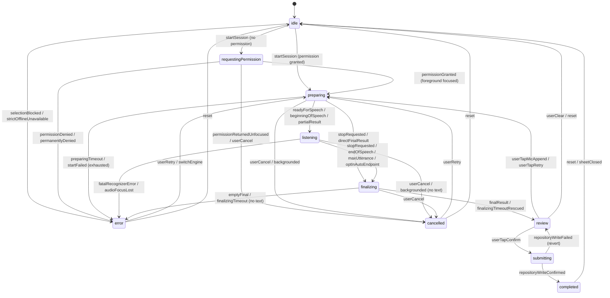

# LifeOS Voice Engine 2.0 — Session State Machine

**Source of Truth:** [voice_session.dart](file:///g:/superapp/lib/features/voice_assistant/domain/entities/voice_session.dart) & [voice_session_coordinator.dart](file:///g:/superapp/lib/features/voice_assistant/domain/services/voice_session_coordinator.dart)

---

## 1. 10-State Formal FSM

---

## 2. Critical Invariants

1. **No Premature Finalization (`VOICE-001`):**
   - `stopSession()` ALWAYS transitions `listening -> finalizing` and arms `finalizingTimeout` (`2200ms`).
   - Confirm (`beginSubmitting()`) and new start (`startSession()` / `retrySession()`) are strictly rejected while `phase == finalizing` (`blocksConfirm == true`, `blocksNewStart == true`).
   - Manual `onUserEditTranscript()` is ignored while `phase == finalizing` to prevent race overwrites before the final native frame settles.

2. **Single Terminal Outcome per Attempt:**
   - Every session ends in at most ONE `VoiceTerminalOutcome`: `finalResult`, `cancelled`, `error`, or `completed`.
   - Once `terminalOutcome.isTerminal == true`, any subsequent delayed callbacks (`onResults`, `onError`, `onEndOfSpeech`) for that `(sessionId, attemptId)` are dropped unconditionally.

3. **Stale Event & Generation Token Protection (`VOICE-002`, `VOICE-004`):**
   - Every envelope event carries `(sessionId, attemptId, sequenceNumber, monotonicTimestampMs)`.
   - Events with mismatched `sessionId`, mismatched `attemptId`, or non-increasing `sequenceNumber` are discarded.
   - Every scheduled timer captures `(sessionId, attemptId, generationToken)` and validates `!_isStaleSession(...)` before acting.

4. **Bounded Retry Policy:**
   - Automatic retry is allowed **ONLY** for `VoiceErrorKind.recognizerBusy` (`ERROR_RECOGNIZER_BUSY`), bounded to **max 1 retry** with a `350ms` backoff after cancelling the prior recognizer instance.
   - Permanent errors (`permissionDenied`, `permissionPermanentlyDenied`, `microphoneInUse`, `noMatch`, `speechTimeout`, `audioFocusLost`, `interruptedByBackground`) NEVER auto-loop or silently fallback.

5. **Timer Budgets (Monotonic Clock):**

| Timer | Default Duration | Action on Expiry |
|---|---|---|
| `preparingTimeout` | `4000 ms` | Fails attempt (`PREPARING_TIMEOUT`) or falls back to next eligible engine (respecting strict offline) |
| `finalizingTimeout` | `2200 ms` | Cancels hung engine; rescues captured partial into `review` if non-empty, else terminal `FINALIZING_TIMEOUT` |
| `maxUtteranceDuration` | `45000 ms` | Triggers graceful `stopSession()` -> `finalizing` |
| `autoEndpointTimer` (opt-in only) | `2000 ms` normal / `3200 ms` dangling | Triggers graceful `stopSession()` only when `VoiceEndpointMode.smartAutoEndpoint` is explicitly enabled |
| `busyRetryDelay` | `350 ms` | Single retry after `ERROR_RECOGNIZER_BUSY` |
