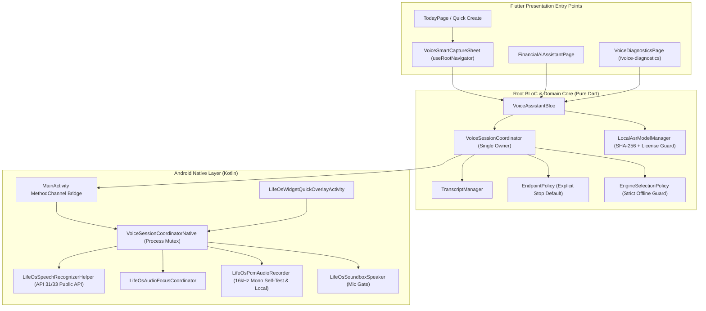

# LifeOS Voice Engine 2.0 — Architecture

**Feature Root:** [lib/features/voice_assistant/](file:///g:/superapp/lib/features/voice_assistant/)
**Android Native Root:** [android/app/src/main/kotlin/vn/lifeos/app/](file:///g:/superapp/android/app/src/main/kotlin/vn/lifeos/app/)

---

## 1. Clean Architecture Layering

Voice Engine 2.0 enforces strict Clean Architecture boundaries:

- **`domain/` (100% Pure Dart — `0` `package:flutter/` imports):**
  - **Entities:** [voice_session.dart](file:///g:/superapp/lib/features/voice_assistant/domain/entities/voice_session.dart), [voice_event.dart](file:///g:/superapp/lib/features/voice_assistant/domain/entities/voice_event.dart), [voice_engine_capability.dart](file:///g:/superapp/lib/features/voice_assistant/domain/entities/voice_engine_capability.dart), [voice_transcript.dart](file:///g:/superapp/lib/features/voice_assistant/domain/entities/voice_transcript.dart), [voice_model_package.dart](file:///g:/superapp/lib/features/voice_assistant/domain/entities/voice_model_package.dart).
  - **Repositories (Contracts):** `VoiceCapabilityRepository`, `LocalAsrModelRepository`.
  - **Domain Services:**
    - [voice_session_coordinator.dart](file:///g:/superapp/lib/features/voice_assistant/domain/services/voice_session_coordinator.dart) — single-owner session coordinator, FSM enforcement, monotonic timers, single-terminal-outcome guarantee, bounded retry (`max 1` on `recognizerBusy`).
    - [transcript_manager.dart](file:///g:/superapp/lib/features/voice_assistant/domain/services/transcript_manager.dart) — overlap-safe partial/final/append/edit merger.
    - [endpoint_policy.dart](file:///g:/superapp/lib/features/voice_assistant/domain/services/endpoint_policy.dart) — explicit-stop default & opt-in acoustic + advisory-semantic endpoint evaluator.
    - [engine_selection_policy.dart](file:///g:/superapp/lib/features/voice_assistant/domain/services/engine_selection_policy.dart) — strict offline enforcement & TTL capability ranking.
    - [voice_activity_detector.dart](file:///g:/superapp/lib/features/voice_assistant/domain/services/voice_activity_detector.dart) — PCM16 ring buffer (`300ms` pre-roll), adaptive Energy/ZCR VAD, truthful waveform samples.
    - [voice_diagnostics.dart](file:///g:/superapp/lib/features/voice_assistant/domain/services/voice_diagnostics.dart) — sanitized PII-free JSON/text report generator.
- **`data/` (Adapters, Channel Bridge, Storage):**
  - [voice_native_channel_datasource.dart](file:///g:/superapp/lib/features/voice_assistant/data/datasources/voice_native_channel_datasource.dart) — `MethodChannel('vn.lifeos.app/voice_assistant')` v2 envelope + v1 compatibility + `BridgeAwareVoiceMethodChannelClient` for widget tests.
  - [local_asr_model_manager.dart](file:///g:/superapp/lib/features/voice_assistant/data/datasources/local_asr_model_manager.dart) — on-demand model downloads with HTTP Range `.part` resume, SHA-256 verification, atomic directory swap, rollback backup, storage pre-check, and commercial license blocking.
  - **Engine Adapters:** `AndroidSpeechEngine`, `AndroidOnDeviceEngine`, `LocalAsrEngine`, `SystemDialogEngine`.
  - [voice_capability_repository_impl.dart](file:///g:/superapp/lib/features/voice_assistant/data/repositories/voice_capability_repository_impl.dart) — 24h TTL environment-keyed capability cache.
- **`presentation/` (Event-Driven `Bloc` — `0` `Cubit`):**
  - [voice_assistant_bloc.dart](file:///g:/superapp/lib/features/voice_assistant/presentation/bloc/voice_assistant_bloc.dart) — root-scoped BLoC (`MultiBlocProvider` in [app.dart](file:///g:/superapp/lib/app/app.dart)).
  - [voice_live_waveform.dart](file:///g:/superapp/lib/features/voice_assistant/presentation/widgets/voice_live_waveform.dart) — truthful waveform painter.
  - [voice_diagnostics_page.dart](file:///g:/superapp/lib/features/voice_assistant/presentation/pages/voice_diagnostics_page.dart) — `/voice-diagnostics` screen.
  - Integrated consumers: [voice_smart_capture_sheet.dart](file:///g:/superapp/lib/core/widgets/voice_smart_capture_sheet.dart), [financial_ai_assistant_page.dart](file:///g:/superapp/lib/features/financial_ai/presentation/pages/financial_ai_assistant_page.dart), [auth_bloc.dart](file:///g:/superapp/lib/features/authentication/presentation/bloc/auth_bloc.dart) (clears voice state on sign-out).

---

## 2. System Component Diagram

---

## 3. Single-Owner Microphone Contract Across Entry Points

1. **In-App Modal Guard:** `_isVoiceCaptureSheetOpen` prevents stacking two `VoiceSmartCaptureSheet` instances simultaneously.
2. **Process-Wide Native Mutex (`VoiceSessionCoordinatorNative.kt`):** All Android mic consumers (`main_activity`, `widget_overlay`, `pcm_self_test`, `pcm_local_capture`) acquire a single lock before touching `SpeechRecognizer` or `AudioRecord`. Contention either cleanly cancels superseded sessions or rejects with `MICROPHONE_IN_USE`.
3. **Zero Silent Financial Commits:** Every voice entry point (including `LifeOsWidgetQuickOverlayActivity`, `VoiceSmartCaptureSheet`, and `FinancialAiAssistantPage`) stops in `review` for explicit user confirmation before mutating transactions, group splits, budgets, or calendar records.
4. **Account Sign-Out Isolation:** `AuthBloc` dispatches `VoiceAccountResetRequested` on sign-out so active capture is terminated and in-memory transcript/timeline state is wiped before switching accounts.
